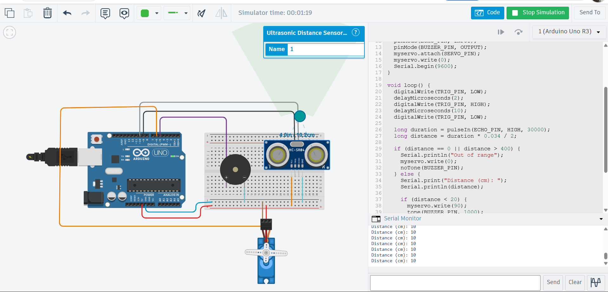

# Assignment B: Distance Alert System (Class 4 Bug Fix)

The class 4 code was written live and isn't available, so I rebuilt a system with the same purpose: an HC-SR04 ultrasonic sensor, a servo and a buzzer on an Arduino Uno, simulated in Tinkercad. When an object is closer than 20 cm, the servo turns to 90 degrees and the buzzer beeps. Otherwise the servo rests at 0 degrees and the buzzer is silent.

Code file: [distance_alert.ino](distance_alert.ino)

## Wiring
| Part | Pin |
|---|---|
| HC-SR04 VCC / GND / Trig / Echo | 5V / GND / D9 / D10 |
| Servo signal | D6 (power from 5V, GND) |
| Buzzer + | D5 (other leg to GND) |

## 1. The issue found
My first version read the distance and checked `distance < 20` straight away. It worked in the simulator at normal distances. But the HC-SR04 returns a duration of **0** when no echo comes back (an object that is too close, too far, or missing). A distance of 0 passes `distance < 20`, so on real hardware the servo and buzzer would react as if an object were very close when nothing is detected. This weakness comes from the class 4 slides, which say `pulseIn` returns 0 when there is no echo. I did not see it fail in Tinkercad, which gave real numbers all the way to 330 cm.

A second problem: `pulseIn` with no timeout can wait up to 1 second for an echo that never comes, which makes the system sluggish.

## 2. How it was solved
- Added a **timeout** to `pulseIn` (30000 microseconds), so it gives up quickly.
- Added an **out-of-range check** before anything else: if the distance is 0 or over 400 cm, print "Out of range", keep the servo at 0 and the buzzer off.
- Only readings that pass this check are compared with 20 cm.

## 3. Line-by-line explanation
| Line | What it does |
|---|---|
| 1 | Loads the Servo library so we can control the servo by angle. |
| 3 | Names pin 9 as the Trig pin, which sends the sound pulse. |
| 4 | Names pin 10 as the Echo pin, which listens for the reflection. |
| 5 | Names pin 5 as the buzzer pin. |
| 6 | Names pin 6 as the servo signal pin. |
| 8 | Creates a servo object called `myservo`. |
| 10 | Starts `setup()`, which runs once when the Arduino powers on. |
| 11 | Sets Trig as an output (the Arduino sends a signal). |
| 12 | Sets Echo as an input (the Arduino receives a signal). |
| 13 | Sets the buzzer pin as an output. |
| 14 | Connects the servo object to pin 6. |
| 15 | Moves the servo to 0 degrees at the start. |
| 16 | Starts the Serial Monitor at 9600 baud so we can print values. |
| 17 | Ends `setup()`. |
| 19 | Starts `loop()`, which repeats forever. |
| 20 | Makes sure Trig is LOW to start clean. |
| 21 | Waits 2 microseconds. |
| 22 | Sets Trig HIGH to start the sound pulse. |
| 23 | Keeps it HIGH for 10 microseconds, which is what the sensor needs. |
| 24 | Sets Trig LOW again, so the sensor sends the sound. |
| 26 | Measures how long Echo stays HIGH (the echo time in microseconds); gives up after 30000 and returns 0. |
| 27 | Converts the time to centimetres: sound travels 0.034 cm per microsecond, and we divide by 2 because it goes there and back. |
| 29 | If the reading is 0 or over 400 cm, there is no valid object. |
| 30 | Prints "Out of range" to the Serial Monitor. |
| 31 | Keeps the servo at 0 degrees. |
| 32 | Makes sure the buzzer is silent. |
| 33 | Otherwise the reading is valid. |
| 34 | Prints the label "Distance (cm): ". |
| 35 | Prints the distance value and moves to a new line. |
| 37 | Checks whether the object is closer than 20 cm. |
| 38 | Turns the servo to 90 degrees. |
| 39 | Plays a 1000 Hz tone on the buzzer. |
| 40 | Waits 200 milliseconds so the beep is heard. |
| 41 | Stops the tone. |
| 42 | Otherwise the object is 20 cm or farther. |
| 43 | Returns the servo to 0 degrees. |
| 44 | Keeps the buzzer silent. |
| 45, 46 | Close the inner `if/else` and the outer `if/else`. |
| 48 | Waits 500 milliseconds before the next measurement. |
| 49 | Ends `loop()`, which then starts again. |

## Result

Object at about 10 cm: the Serial Monitor prints the distance, the servo turns to 90 degrees and the buzzer sounds.
