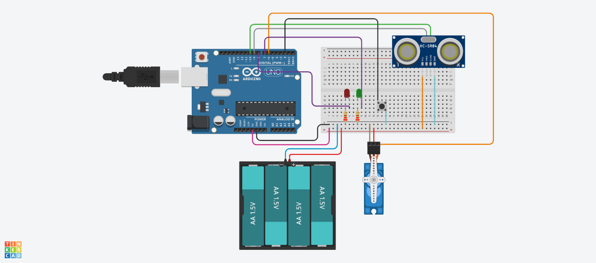

# Assignment C: Touchless Smart Dustbin

**Microcontroller:** Arduino Uno R3
**Sensor:** HC-SR04 ultrasonic distance sensor
**Actuator:** Micro servo (acts as the lid)
**Platform:** Tinkercad Circuits
**Simulation link:** (https://www.tinkercad.com/things/cJZKiNB0QG3-smart-dustbin)

---

## 1. The Problem

Opening a dustbin lid by hand means touching a dirty surface, which spreads germs. This project builds a **touchless dustbin**: when a hand or an item comes close, the lid opens by itself, and when it moves away, the lid closes.

It follows the basic robot loop from Class 1: **sense, decide, act**.

| Step | Part | Job |
|---|---|---|
| Sense | Ultrasonic sensor | Measures how far away the object is |
| Decide | Arduino code | Checks if the object is closer than 20 cm |
| Act | Servo | Swings the lid open or closed |

In the simulation there is no physical lid, so the **servo arm stands in for the lid**: 0 degrees is closed and 90 degrees is open.

---

## 2. Demo

Video: [add a link or the video file name here]

---

## 3. Components

| Component | Quantity | Notes |
|---|---|---|
| Arduino Uno R3 | 1 | The brain |
| HC-SR04 ultrasonic sensor | 1 | Measures distance |
| Micro servo | 1 | Moves the lid |
| Battery pack (4 x AA, 6V) | 1 | Powers the servo |
| Green LED | 1 | Lid closed, ready |
| Red LED | 1 | Lid open |
| Resistor, 220 ohm | 2 | Protects the LEDs |
| Push button | 1 | Hold the lid open manually |
| Breadboard and jumper wires | | Connections |

---

## 4. Wiring

### Pin map

| Part | Connects to |
|---|---|
| Ultrasonic TRIG | Arduino D9 |
| Ultrasonic ECHO | Arduino D10 |
| Servo signal (orange) | Arduino D6 |
| Green LED (through a resistor) | Arduino D7 |
| Red LED (through a resistor) | Arduino D8 |
| Push button | Arduino D2 and GND |

### Power
- **Arduino 5V and GND** feed the top breadboard strips, which power the ultrasonic sensor.
- **Battery pack + and -** feed the bottom breadboard strips, which power the servo.
- The two **GND (blue) strips are joined** with one wire so everything shares the same ground. Without a common ground, the Arduino's signal means nothing to the servo.
- The two **red (+) strips are not joined**, so the 6V battery never reaches the sensor or the Arduino.

**Why a separate battery for the servo?** A servo is a motor, and motors draw sudden bursts of current. Powering it from the Arduino's 5V pin can make the board glitch or restart. A separate battery keeps the Arduino and the sensor readings stable, and it also lets the bin run without a computer cable.

---

## 5. How It Works

### Measuring distance (Class 4)
1. The Arduino sets TRIG HIGH for 10 microseconds. The sensor sends out a burst of ultrasonic sound.
2. The sound hits an object and bounces back. ECHO stays HIGH for as long as the round trip takes.
3. `pulseIn()` measures that time in microseconds.
4. `distance (cm) = time x 0.034 / 2`. The speed of sound is about 0.034 cm per microsecond, and we divide by 2 because the sound travels to the object and back.

### Making the readings reliable (Class 4)
- **Averaging:** the code takes 5 readings and averages them, so one bad reading cannot flick the lid open.
- **Out-of-range handling:** a reading of 0 means no echo came back, and the sensor cannot be trusted past 400 cm. Those readings are thrown away. If every reading is bad, the code prints "Out of range" and keeps the lid closed.

### Moving the lid (Class 3)
`write(angle)` tells the servo which angle to hold. The code moves one degree at a time with a 10 ms pause, so the lid glides instead of snapping.

### Status LEDs (Class 1)
`digitalWrite(pin, HIGH)` turns an LED on and `LOW` turns it off. **Green** means the lid is closed and ready. **Red** means the lid is open.

### Manual button (Class 2)
The button uses `INPUT_PULLUP`, so the pin sits HIGH by itself and pressing the button connects it to ground, which reads LOW. While the button is held, the lid stays open and the sensor is ignored. This is useful when emptying the bin.

---

## 6. Code

File: [`smart_dustbin.ino`](smart_dustbin.ino)

### Settings at the top of the code

| Name | Value | Meaning |
|---|---|---|
| `OPEN_DISTANCE` | 20 | Open the lid when something is closer than 20 cm |
| `CLOSED_ANGLE` | 0 | Servo angle for a closed lid |
| `OPEN_ANGLE` | 90 | Servo angle for an open lid |
| `NUM_READINGS` | 5 | How many readings are averaged |

Changing a setting in one place changes the behavior everywhere.

### Function by function

| Part of the code | What it does |
|---|---|
| `readDistance()` | Fires one ping and returns the distance in cm (0 if no echo) |
| `averageDistance()` | Takes 5 readings, ignores bad ones, and returns the average |
| `setLeds(bool lidOpen)` | Red on and green off when open, the opposite when closed |
| `moveLidTo(target)` | Moves the servo one degree at a time and sets the LEDs |
| `setup()` | Sets pin modes, attaches the servo, starts with the lid closed |
| `loop()` | Checks the button, then the sensor, then moves the lid |

### Why `pulseIn(ECHO_PIN, HIGH, 30000)` has a timeout
The `30000` means "stop waiting after 30,000 microseconds". If nothing is in front of the sensor, no echo returns, and without a timeout the code would wait far too long.

### Why `distance > 0` matters
A reading of 0 means no echo, not "touching the sensor". Treating it as a real distance would open the lid for no reason.

---

## 7. How to Run

1. Open the Tinkercad link, or rebuild the circuit from the wiring section.
2. Click **Start Simulation** and open the **Serial Monitor**.
3. The green LED lights up (lid closed).
4. Click the ultrasonic sensor and drag the small object closer than 20 cm. The servo swings open and the red LED lights up.
5. Drag it away. The servo swings back and the green LED returns.
6. Hold the push button. The servo opens even with nothing near.

---

## 8. Issues Faced and How I Solved Them

*(Fill this in with your own experience, for example a wire on the wrong strip or a wrong pin. Write what went wrong, how you found it, and how you fixed it.)*

---

## 9. Skills Used From Each Class

| Class | Skill used in this project |
|---|---|
| 1. Foundations | Sense, decide, act; LEDs with HIGH and LOW |
| 2. Programming | Variables and constants, if/else, `INPUT_PULLUP` button, Serial Monitor, functions |
| 3. Actuators | Servo angles and smooth movement |
| 4. Sensors | HC-SR04 timing, distance formula, averaging, out-of-range handling |

---

## 10. Possible Improvements

- **Bluetooth control (Class 5):** open the lid from a phone, using a Bluetooth module on real hardware.
- **Bin-full detector:** a second ultrasonic sensor inside the bin to measure how full it is, with an alert.
- **Real hardware build:** attach the servo to an actual lid, and power the Arduino from a battery too.
