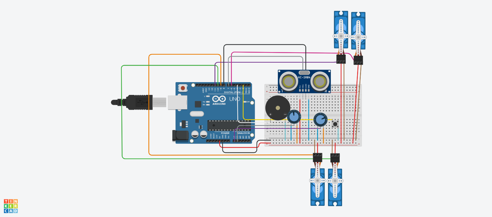

# Capstone Project: Autonomous & Manual Robotic Arm Simulation

A 4-servo robotic arm simulated on an Arduino Uno. It can be driven **manually** with potentiometers, or run **autonomously**, detecting, picking and placing objects using an ultrasonic sensor.

## Demo

Simulation link: https://www.tinkercad.com/things/9diCB8d5leN-capstone-project

## Components
| Component | Qty | Role |
|---|---|---|
| Arduino Uno (microcontroller) | 1 | Brain of the system |
| HC-SR04 ultrasonic sensor | 1 | Object detection and distance |
| Piezo buzzer | 1 | Audio feedback and warnings |
| Potentiometer | 2 | Manual control (base, reach) |
| Servo motor | 4 | Base, shoulder, elbow, gripper |
| Push button | 1 | Switch between modes |

## Wiring
| Part | Arduino Pin |
|---|---|
| Ultrasonic TRIG | D7 |
| Ultrasonic ECHO | D8 |
| Buzzer (+) | D4 |
| Mode button | D2 (other leg to GND, INPUT_PULLUP) |
| Pot 1 (base) wiper | A0 |
| Pot 2 (reach) wiper | A1 |
| Servo: base | D9 |
| Servo: shoulder | D10 |
| Servo: elbow | D11 |
| Servo: gripper | D6 |
| All power and ground | 5V and GND (common ground) |

## How it works

### Manual mode (default)
- Pot 1 rotates the base (0-180 degrees).
- Pot 2 extends the arm: the shoulder follows the pot and the elbow mirrors it.
- If an object comes within 8 cm of the sensor, the buzzer sounds a warning.

### Autonomous mode (press the button)
1. The base sweeps between 10 and 170 degrees while the ultrasonic sensor scans.
2. When an object is within 20 cm, the arm stops and the buzzer beeps.
3. The arm reaches out, closes the gripper, lifts, rotates to the drop zone and releases.
4. It returns home and resumes scanning.

Each button press toggles the mode and beeps: 1 beep for manual, 2 beeps for autonomous.

## Code breakdown
Code file: `robotic_arm.ino`

| Function | What it does |
|---|---|
| `readDistanceCm()` | Sends a trigger pulse and converts the echo time to centimetres (duration x 0.034 / 2) |
| `smoothMove()` | Moves a servo 1 degree at a time for smooth motion |
| `goHome()` | Returns all servos to the starting position |
| `checkModeButton()` | Debounced button read that toggles manual/autonomous |
| `manualMode()` | Reads the pots, moves the servos, handles the proximity warning |
| `autonomousMode()` | Sweeps the base and scans for objects |
| `pickAndPlace()` | The pick-up, move and release sequence |
| `loop()` | Checks the button, then runs the active mode |

## How to run
1. Open the simulation link above, or recreate the circuit in Tinkercad using the wiring table.
2. Paste `robotic_arm.ino` into the code editor (Text mode).
3. Click **Start Simulation** and open the Serial Monitor.
4. Turn the pots to test manual mode.
5. Press the button, then drag the ultrasonic object to about 15 cm to trigger pick-and-place.

## What I learned
- Reading analog inputs and mapping them to servo angles
- Measuring distance with an ultrasonic sensor
- Structuring code around modes using a state variable
- Smooth servo control and button debouncing
- Debugging circuits and code in a simulator

## Future improvements
- Sort objects by distance
- Add an LCD for live status
- Build the physical arm
