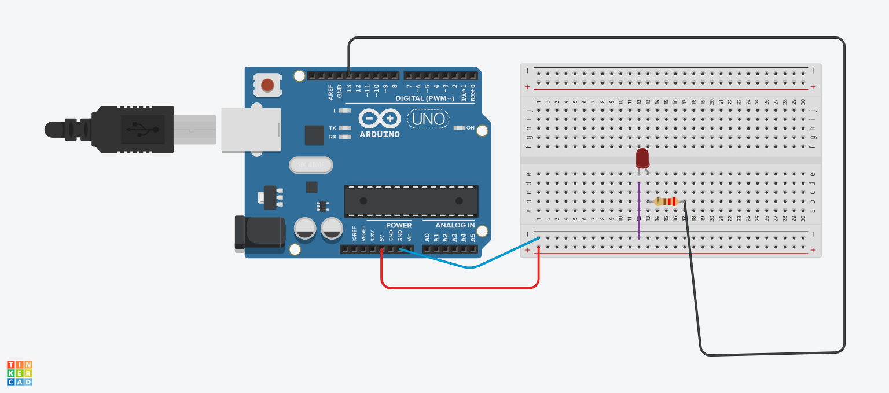
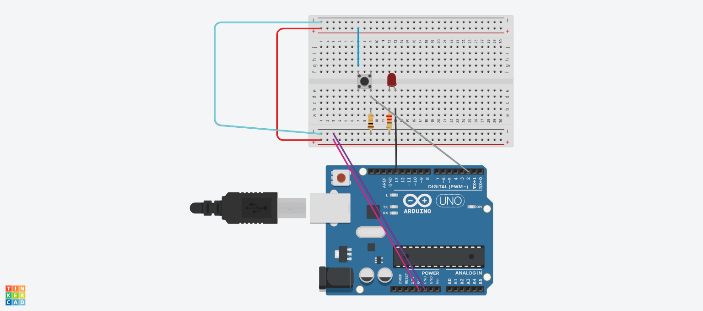

# LED Basics: Blink and Button

Two simple LED exercises on an Arduino Uno, simulated in Tinkercad Circuits.

## 1. LED blink (no button)
An LED on pin 13 (through a resistor) turns on for 1 second, then off for 1 second, repeatedly.

Code: [blink.ino](blink.ino)

| Part | What it does |
|---|---|
| `const int ledPin = 13;` | Names pin 13 as the LED pin. |
| `pinMode(ledPin, OUTPUT);` | Sets pin 13 as an output, so the Arduino can power the LED. Runs once in `setup()`. |
| `digitalWrite(ledPin, HIGH);` | Sends 5V to the pin, so the LED turns on. |
| `delay(1000);` | Waits 1000 milliseconds (1 second). |
| `digitalWrite(ledPin, LOW);` | Sets the pin to 0V, so the LED turns off. |
| `delay(1000);` | Waits 1 second again, then `loop()` repeats. |

## 2. LED with a button
An LED on pin 13 turns on while a button on pin 2 is pressed, and off when it is released.

Code: [button_led.ino](button_led.ino)

| Part | What it does |
|---|---|
| `int buttonState = 0;` | A variable that stores whether the button is pressed. |
| `pinMode(2, INPUT);` | Pin 2 reads the button. |
| `pinMode(13, OUTPUT);` | Pin 13 powers the LED. |
| `digitalRead(2)` | Reads the button: HIGH when pressed, LOW when not. |
| `if (buttonState == HIGH)` | If the button is pressed, send HIGH to pin 13 (LED on). |
| `else` | Otherwise send LOW to pin 13 (LED off). |
| `delay(15);` | A short pause that keeps the simulation smooth. |

## Difference between the two
The blink program runs by itself on a timer. The button program waits for an input and reacts to it.
