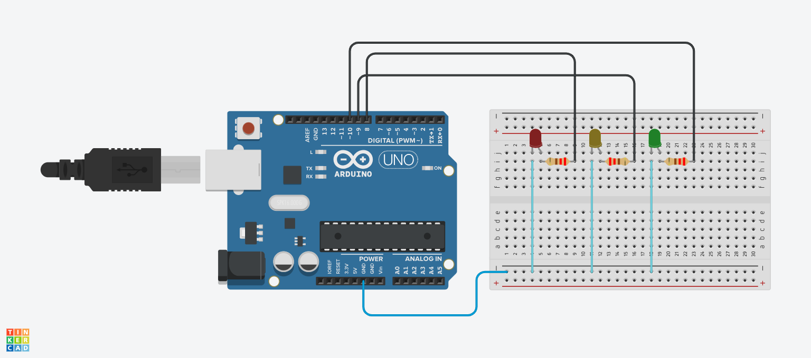

# Traffic Light Controller

Three LEDs (red, yellow, green), each with a resistor, connected to an Arduino Uno and simulated in Tinkercad Circuits. They light up one at a time in the order of a real traffic light: red, then green, then yellow, then red again.

Code: [traffic_light.ino](traffic_light.ino)

## Wiring
| LED | Arduino pin |
|---|---|
| Red | 8 |
| Yellow | 9 |
| Green | 10 |

Each LED has a resistor in series, and all three LED cathodes go to GND.

## Timing
| Light | Duration |
|---|---|
| Red | 4 seconds |
| Green | 4 seconds |
| Yellow | 1.5 seconds |

## How the code works
| Part | What it does |
|---|---|
| `const int redPin = 8;` (and yellow, green) | Names the pin each LED is connected to, so the code is easier to read and change. |
| `const int redDuration = 4000;` (and green, yellow) | Stores how long each light stays on, in milliseconds (1000 ms = 1 second). |
| `pinMode(..., OUTPUT);` | Sets each LED pin as an output so the Arduino can power the LED. Runs once in `setup()`. |
| `digitalWrite(redPin, HIGH);` | Sends 5V to the pin, so the red LED turns on. |
| `delay(redDuration);` | Keeps the light on for 4 seconds. |
| `digitalWrite(redPin, LOW);` | Turns the red LED off. |
| Green block | The same three steps for green (on, wait 4 seconds, off). |
| Yellow block | The same three steps for yellow (on, wait 1.5 seconds, off). |
| End of `loop()` | The cycle repeats from red, forever. |
